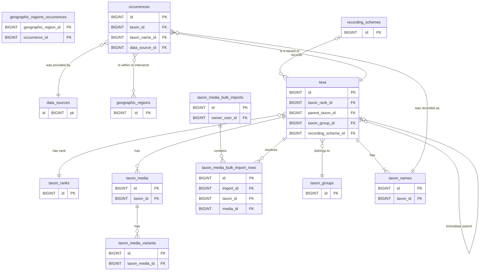

# Database schema

## Temporary admin export storage

### export_jobs

Browser-driven CSV jobs store an owner ID and opaque UUID, resource and frozen JSON contract,
including the optional grid-count estimate and statistics scope caption. The estimate is retained
for progress only; capture termination and CSV writing use actual matching rows. Jobs also store
phase/status, source high-water ID and capture cursor, captured row/payload counters, written row
count, committed file offset and output cursor. Creation/progress, capture completion, completion
and expiry timestamps describe the rolling capture; `error` contains a safe user-facing failure.
`staging_cleaned` and `files_cleaned` record bounded cleanup completion so retained history cannot
starve newer jobs of cleanup.
`capture_started_at` records the first committed capture batch separately from job creation and
the ID ceiling. `delivery_until` gives offloaded delivery a short file-opening grace period;
download authorisation still enforces the original expiry.

Indexes support UUID lookup, owner/status history, inactive jobs and file expiry. There is no
foreign key to the owner: deleting a user must not cascade away cleanup metadata or trigger a
large staging deletion. All web access checks current ownership and staff membership.

### export_rows

Immutable captured rows use a compound primary key `(job_id, record_id)`. `payload` stores the
projected CSV cells as JSON. `sort_present`, `sort_value`, `date_present` and `date_value` freeze
the grid's primary and secondary ordering; an indexed compound key ending in `record_id`
supports ascending and descending keyset output. Numeric keys use order-preserving text encoding.
Text keys retain the database collation, which export creation validates against the source.

MySQL uses `VARCHAR(255)` for the primary key value, keeping the compound index below the
modern InnoDB 3,072-byte key limit with utf8mb4. Legacy InnoDB configurations with smaller key
limits require upgrading their index configuration before installing the migration.
The migration explicitly selects InnoDB for both export tables on MySQL-compatible drivers
so capture/checkpoint transactions remain atomic even if the server default engine differs.
SQLite uses its native text ordering for portable tests. Source relationships are deliberately
not foreign keys: deleting/editing live data must not alter captured rows.

Rows are removed in bounded cleanup batches after CSV completion, cancellation or expiry.
No cascading job foreign key is used, so cleanup can remove millions of rows incrementally.
Database payload limits measure JSON bytes only; provision additional space for rows, indexes
and transactional overhead. Completed files expire after 24 hours, inactive unfinished jobs
after 24 hours without committed progress, and terminal metadata after configurable retention.

Tanhub stores a normalized copy of taxonomy and occurrence data for fast, consistent reporting. It
keeps the source identity of each record, but the schema is not a raw archive of every source field.

The schema follows [Darwin Core](https://dwc.tdwg.org/) where that makes sense and supports imports
from the UKSI species database. Fields that map directly to Darwin Core are marked with `DwC` and
the relevant property name.

Each API resource has a stable unique field. Tanhub uses a Darwin Core field where possible and a
UUID where no suitable source field exists. Use that field in API URLs; do not use the internal
auto-incrementing `id`.

## Entity Relationship Diagram

## Why taxon rank columns are dynamic

Taxonomic hierarchy is stored using dynamic foreign-key columns on both the `taxa` and
`occurrences` tables. During installation, Tanhub adds one column for each configured reporting
rank, using the pattern `<rank>_id` (for example `kingdom_id`, `class_id`, `family_id`, `order_id`).

Each column points to `taxa.id`. This self-referencing design avoids a separate table for every
possible rank. `taxa.parent_taxon_id` stores the immediate accepted parent, while the rank columns
store projections to the reporting levels chosen by the installation. Occurrences retain their
exact `taxon_id` and copy those projections so exact lookup and fast reporting can coexist.

## Imported data table details

The following data tables contain normalized data imported into tanhub.

### data_sources

Lookup table for names of data sources such as iRecord and the NBN Atlas.

| Column | Type         | Null | Key | Default        | Description                                                           |
| ------ | ------------ | ---- | --- | -------------- | --------------------------------------------------------------------- |
| id     | BIGINT       | NO   | PK  | AUTO_INCREMENT | Primary key                                                           |
| abbr   | VARCHAR(10)  | NO   | UQ  |                | A unique one-word abbreviation for the data source, e..g NBN, iRecord |
| title  | VARCHAR(100) | NO   | UQ  |                | Name of the source of records, e.g. NBN Atlas or iRecord              |
| url    | VARCHAR(100) | NO   |     |                | Associated website URL                                                |

### geographic_regions

Lists the regions which define the geographical constraint of the data held in the system.
Populated from Indicia using the `.env` file's grouped `import.geographicRegions` JSON.
Regions of different types can overlap. A region uses its non-blank Indicia location code,
or its location ID when the code is blank; the geographic-region and grid-square reports use
the same identifier contract. Configured region identifiers must be unique.

| Column                      | Type         | Null | Key | Default           | Description                                                               |
| --------------------------- | ------------ | ---- | --- | ----------------- | ------------------------------------------------------------------------- |
| id                          | BIGINT       | NO   | PK  | AUTO_INCREMENT    | Primary key                                                               |
| higher_geography_identifier | VARCHAR(100) | NO   | UQ  |                   | Identifier for the geographic region, e.g. a Watsonian Vice-County number |
| higher_geography            | VARCHAR(100) | NO   |     |                   | Geographic name of the region                                             |
| location_type               | VARCHAR(100) | NO   |     |                   | Name of the type of location                                              |
| footprint_geometry          | GEOMETRY     | YES  |     |                   | Optional footprint or boundary in WGS84 (EPSG:4326)                       |
| data_source_id              | BIGINT       | NO   | FK  |                   | ID of the source of the data (iRecord, NBN Atlas etc)                     |
| created_at                  | DATETIME     | NO   |     | CURRENT_TIMESTAMP | Creation date                                                             |
| updated_at                  | DATETIME     | YES  |     |                   | Update date                                                               |
| deleted_at                  | DATETIME     | YES  |     |                   | Deletion date                                                             |

### geographic_regions_occurrences

Join table linking occurrences to the regions they were recorded in. Typically
contains a single region per occurrence but may contain multiple if occurrences
overlap region boundaries.

| Column               | Type   | Null | Key    | Default | Description                                                |
| -------------------- | ------ | ---- | ------ | ------- | ---------------------------------------------------------- |
| geographic_region_id | BIGINT | NO   | PK, FK |         | Compound primary key and foreign key to geographic regions |
| occurrence_id        | BIGINT | NO   | PK, FK |         | Compound primary key and foreign key to occurrences        |

### occurrences

Occurrence data stored in the system, imported from a source such as iRecord or the NBN Atlas. A
reference to the original record is held in the unique_key field, constructed from the data_source
abbreviation, then a colon, then the unique ID of the record as loaded from the remote system.

| Column                             | Type          | Null | Key | Default           | Description                                                                                                                         |
| ---------------------------------- | ------------- | ---- | --- | ----------------- | ----------------------------------------------------------------------------------------------------------------------------------- |
| id                                 | BIGINT        | NO   | PK  | AUTO_INCREMENT    | Primary key                                                                                                                         |
| unique_key                         | VARCHAR(100)  | NO   | UQ  |                   | Unique key for the API                                                                                                              |
| taxon_id                           | BIGINT        | NO   | FK  |                   | ID of the exact taxon this is a record of                                                                                           |
| <rank>_id                          | BIGINT        | YES  | FK  |                   | Dynamic taxon-rank FK (for each configured rank), references `taxa.id` and points to a reporting taxon                              |
| taxon_name_id                      | BIGINT        | NO   | FK  |                   | ID of the name given for this occurrence which may be accepted, synonym or vernacular                                               |
| from_date                          | DATE          | YES  |     |                   | Start of the date range that covers the record                                                                                      |
| to_date                            | DATE          | YES  |     |                   | End of the date range that covers the record                                                                                        |
| grid_ref                           | VARCHAR(20)   | NO   |     |                   | OSGB grid reference                                                                                                                 |
| grid_ref_2km                       | CHAR(5)       | YES  |     |                   | 2km (DINTY) grid ref that best fits the record, null for less precise records                                                       |
| locality                           | VARCHAR(255)  | YES  |     |                   | Site name associated with the record                                                                                                |
| recorded_by                        | VARCHAR(255)  | NO   |     |                   | Name of the person or agent that recorded the occurrence                                                                            |
| identified_by                      | VARCHAR(255)  | YES  |     |                   | Name of person or agent that made the identification                                                                                |
| identification_verification_status | VARCHAR(2)    | NO   |     |                   | Verification status code, compatible with iRecord codes (V=Verified, C=Data entry complete pending verification, plus Un = unknown) |
| sex                                | VARCHAR(20)   | YES  |     |                   | Sex of the organism if known                                                                                                        |
| life_stage                         | VARCHAR(20)   | YES  |     |                   | Life stage of the organism if known                                                                                                 |
| organism_quantity                  | VARCHAR(20)   | YES  |     |                   | A number or enumeration value for the quantity of organisms                                                                         |
| data_source_id                     | BIGINT        | NO   | FK  |                   | ID of the source of the data (iRecord, NBN Atlas etc)                                                                               |
| latitude                           | DECIMAL(10,7) | YES  |     |                   | Latitude of the occurrence, when supplied                                                                                           |
| longitude                          | DECIMAL(10,7) | YES  |     |                   | Longitude of the occurrence, when supplied                                                                                          |
| blocked                            | TINYINT(1)    | NO   |     |                   | 1 = occurrence is blocked from reports, 0 otherwise                                                                                 |
| blocked_reason                     | TEXT          | YES  |     |                   | Reason given for blocking the record                                                                                                |
| created_at                         | DATETIME      | NO   |     | CURRENT_TIMESTAMP | Creation date                                                                                                                       |
| updated_at                         | DATETIME      | YES  |     |                   | Update date                                                                                                                         |
| deleted_at                         | DATETIME      | YES  |     |                   | Deletion date                                                                                                                       |

### recording_schemes

Recording schemes associated with taxa loaded in the system.

| Column       | Type         | Null | Key | Default           | Description                                                                                                   |
| ------------ | ------------ | ---- | --- | ----------------- | ------------------------------------------------------------------------------------------------------------- |
| id           | BIGINT       | NO   | PK  | AUTO_INCREMENT    | Primary key                                                                                                   |
| external_key | CHAR(16)     | NO   | UQ  |                   | Key for the scheme as assigned from the external database the data were imported from, unique key for the API |
| title        | VARCHAR(100) | NO   |     |                   | Title of the scheme                                                                                           |
| description  | TEXT         | YES  |     |                   | Optional description of the scheme                                                                            |
| created_at   | DATETIME     | NO   |     | CURRENT_TIMESTAMP | Creation date                                                                                                 |
| updated_at   | DATETIME     | YES  |     |                   | Update date                                                                                                   |
| deleted_at   | DATETIME     | YES  |     |                   | Deletion date                                                                                                 |

### taxa

Details of species concepts. May also contain other reportable taxonomic levels (e.g. aggregates).
Taxa are generally imported but species account text may be added locally. Where a field maps
directly to a Darwin Core concept, this is indicated in the description.

| Column                     | Type         | Null | Key | Default           | Description                                                                         |
| -------------------------- | ------------ | ---- | --- | ----------------- | ----------------------------------------------------------------------------------- |
| id                         | BIGINT       | NO   | PK  | AUTO_INCREMENT    | Primary key                                                                         |
| taxon_identifier           | VARCHAR(100) | NO   | UQ  |                   | Taxon identifier, DwC taxonID, Unique key for the API.                              |
| scientific_name_identifier | VARCHAR(100) | NO   |     |                   | Unique identifier of the accepted name, DwC scientificNameID                        |
| scientific_name            | VARCHAR(200) | NO   |     |                   | Accepted scientific taxon name, DwC scientificName                                  |
| scientific_name_authorship | VARCHAR(100) | YES  |     |                   | Taxon name author, DwC scientificNameAuthorship                                     |
| vernacular_name            | VARCHAR(200) | NO   |     |                   | Common taxon name, DwC vernacularName                                               |
| taxon_rank_id              | BIGINT       | NO   | FK  |                   | ID of the taxon rank                                                                |
| parent_taxon_id            | BIGINT       | YES  | FK  |                   | ID of the immediate accepted parent taxon                                           |
| <rank>_id                  | BIGINT       | YES  | FK  |                   | Dynamic taxon-rank FK (for each configured rank), references `taxa.id`              |
| taxon_group_id             | BIGINT       | NO   | FK  |                   | ID of the taxon reporting group                                                     |
| id_difficulty              | TINYINT      | YES  |     |                   | Record Cleaner ID difficulty (1-5)                                                  |
| recording_scheme_id        | BIGINT       | YES  | FK  |                   | ID of the associated recording scheme                                               |
| conservation_status        | VARCHAR(10)  | YES  |     |                   | Abbreviation of the taxon's conservation designation                                |
| taxon_remarks              | TEXT         | YES  |     |                   | Species account text if provided, DwC taxonRemarks                                  |
| rarity_group_name          | VARCHAR(100) | NO   |     |                   | Grouping of taxa whose rarities are compared together when calculating the category |
| rarity_category            | TINYINT      | YES  |     |                   | Assigned category of rarity from 1 (rare) to 5 (common), populated by `php spark stats:taxon-rarity`            |
| blocked                    | TINYINT(1)   | NO   |     |                   | 1 = species is blocked from searches, 0 otherwise                                   |
| blocked_reason             | TEXT         | YES  |     |                   | Reason given for blocking the record                                                |
| created_at                 | DATETIME     | NO   |     | CURRENT_TIMESTAMP | Creation date                                                                       |
| updated_at                 | DATETIME     | YES  |     |                   | Update date                                                                         |
| deleted_at                 | DATETIME     | YES  |     |                   | Deletion date                                                                       |

`parent_taxon_id` is an FK to the immediate accepted parent. The dynamic `<rank>_id` columns are
configured reporting projections and must not replace the exact hierarchy.

Note that when tanhub is linked to UKSI as its source of taxonomic data, the following applies:
- taxon_identifier will contain `ORGANISM_KEY`, the UKSI provided unique identifier of the organism
  and unique ID for the API.
- scientific_name_identifier will contain the unique identifier of the accepted taxon name, the
  `TAXON_VERSION_KEY`.
- conservation_status will hold the GB Red List designation's abbreviation, e.g. LC or VU.

### taxon_media

Uploaded media assets attached to a taxon. The `storage_path` is relative to
`writable/uploads/taxon-media` and `uuid` is the stable identifier used by media delivery URLs.

| Column            | Type         | Null | Key | Default           | Description                                      |
| ----------------- | ------------ | ---- | --- | ----------------- | ------------------------------------------------ |
| id                | BIGINT       | NO   | PK  | AUTO_INCREMENT    | Primary key                                      |
| uuid              | CHAR(36)     | NO   | UQ  |                   | Stable media identifier used in delivery routes  |
| taxon_id          | BIGINT       | NO   | FK  |                   | Foreign key to `taxa.id`                         |
| original_filename | VARCHAR(255) | NO   |     |                   | Original client filename                         |
| storage_path      | VARCHAR(255) | NO   |     |                   | Relative path to stored original image           |
| mime_type         | VARCHAR(100) | NO   |     |                   | Uploaded MIME type                               |
| bytes             | INT          | NO   |     |                   | File size in bytes                               |
| width             | INT          | YES  |     |                   | Pixel width (if detected)                        |
| height            | INT          | YES  |     |                   | Pixel height (if detected)                       |
| alt_text          | TEXT         | YES  |     |                   | Accessibility alt text                           |
| caption           | TEXT         | YES  |     |                   | Optional public caption                          |
| attribution       | VARCHAR(255) | YES  |     |                   | Attribution/credit text                          |
| license           | VARCHAR(100) | YES  |     |                   | License label                                    |
| sort_order        | INT          | NO   |     | 0                 | Display ordering within a taxon                  |
| is_primary        | TINYINT(1)   | NO   |     | 0                 | 1 if primary image for a taxon, otherwise 0      |
| created_at        | DATETIME     | NO   |     | CURRENT_TIMESTAMP | Creation date                                    |
| updated_at        | DATETIME     | YES  |     |                   | Update date                                      |
| deleted_at        | DATETIME     | YES  |     |                   | Soft delete date                                 |
| bulk_import_id    | BIGINT       | YES  | FK  |                   | Pending bulk import; null after publication     |

Indexes and constraints:

- Unique index on `uuid`.
- Index on `taxon_id`.
- Composite index on `taxon_id, sort_order`.
- FK `taxon_id` references `taxa.id` with cascade delete.
- Index and FK on `bulk_import_id`; references `taxon_media_bulk_imports.id` with `SET NULL` on
  delete.
- On MySQL, insert and update triggers reject a second published primary media item for a taxon.
  Staged bulk-import media remains non-primary until publication.
- On SQLite and PostgreSQL, an equivalent partial unique index is used without a generated column.
- Rows with a non-null `bulk_import_id` are pending bulk-import publication and are excluded from
  normal media reads until publication clears the value.

### taxon_media_variants

Derived image sizes for each row in `taxon_media` (for example `thumbnail` and `large`).

| Column         | Type         | Null | Key     | Default           | Description                             |
| -------------- | ------------ | ---- | ------- | ----------------- | --------------------------------------- |
| id             | BIGINT       | NO   | PK      | AUTO_INCREMENT    | Primary key                             |
| taxon_media_id | BIGINT       | NO   | FK, UQ* |                   | FK to `taxon_media.id`                  |
| variant_key    | VARCHAR(50)  | NO   | UQ*     |                   | Variant name, e.g. `thumbnail`, `large` |
| storage_path   | VARCHAR(255) | NO   |         |                   | Relative path to derived file           |
| mime_type      | VARCHAR(100) | NO   |         |                   | MIME type of the derived file           |
| bytes          | INT          | NO   |         |                   | File size in bytes                      |
| width          | INT          | YES  |         |                   | Pixel width of derived file             |
| height         | INT          | YES  |         |                   | Pixel height of derived file            |
| created_at     | DATETIME     | NO   |         | CURRENT_TIMESTAMP | Creation date                           |

UQ* indicates a composite unique index across `taxon_media_id` and `variant_key`.

Additional constraints:

- Index on `taxon_media_id`.
- FK `taxon_media_id` references `taxon_media.id` with cascade delete.

### taxon_media_bulk_imports

Tracks a user-created bulk taxon media import from CSV upload through validation, background
processing, publication, or cancellation. The CSV is retained in staging while its rows are
resolved to taxa and paired with uploaded image files. The worker uses `next_row_id` and the row
statuses to resume after a time-limited run.

| Column             | Type         | Null | Key       | Default           | Description                                  |
| ------------------ | ------------ | ---- | --------- | ----------------- | -------------------------------------------- |
| id                 | BIGINT       | NO   | PK        | AUTO_INCREMENT    | Internal import identifier                   |
| uuid               | CHAR(36)     | NO   | UQ        |                   | Public identifier for import status requests |
| owner_user_id      | INT          | YES  | FK        |                   | Shield user who created the import           |
| csv_filename       | VARCHAR(255) | NO   |           |                   | Original CSV filename                        |
| csv_path           | VARCHAR(500) | NO   |           |                   | Server-side staging path for the CSV         |
| status             | VARCHAR(20)  | NO   |           | queued            | Import lifecycle status                      |
| total_rows         | INT          | NO   |           | 0                 | Number of validated CSV rows                 |
| processed_rows     | INT          | NO   |           | 0                 | Number of rows processed by the worker       |
| next_row_id        | BIGINT       | YES  |           |                   | Next staged row checkpoint                   |
| error_message      | TEXT         | YES  |           |                   | Batch-level error message                    |
| validation_report  | TEXT         | YES  |           |                   | Serialized validation or row error report    |
| heartbeat_at       | DATETIME     | YES  |           |                   | Last worker heartbeat                        |
| started_at         | DATETIME     | YES  |           |                   | Processing start time                        |
| finished_at        | DATETIME     | YES  |           |                   | Completion, failure, or cancellation time    |
| created_at         | DATETIME     | NO   |           | CURRENT_TIMESTAMP | Creation time                                |
| updated_at         | DATETIME     | YES  |           |                   | Last update time                             |

The main statuses are `draft`, `uploading`, `queued`, `processing`, `published`, `failed`, and
`cancelled`. An index on `owner_user_id, status` supports the user's import list, while an index
on `status, next_row_id` supports worker selection. `owner_user_id` references `users.id` with
cascade delete.

### taxon_media_bulk_import_rows

Stores one validated CSV row and its staged photo for a bulk import. It keeps the resolved
`taxon_id`, media metadata, file integrity details, and worker result separate from permanent
`taxon_media` rows until the complete import is published.

| Column             | Type         | Null | Key       | Default           | Description                                  |
| ------------------ | ------------ | ---- | --------- | ----------------- | -------------------------------------------- |
| id                 | BIGINT       | NO   | PK        | AUTO_INCREMENT    | Internal staged-row identifier               |
| import_id          | BIGINT       | NO   | FK, UQ*   |                   | Parent bulk import                           |
| row_number         | INT          | NO   | UQ*       |                   | One-based CSV row number                    |
| taxon_id           | BIGINT       | NO   | FK        |                   | Resolved target taxon                        |
| photo_filename     | VARCHAR(255) | NO   |           |                   | Case-sensitive uploaded basename             |
| staged_path        | VARCHAR(500) | YES  |           |                   | Server-side staged image path                |
| mime_type          | VARCHAR(100) | YES  |           |                   | Validated staged image MIME type             |
| staged_bytes       | BIGINT       | NO   |           | 0                 | Staged image size in bytes                   |
| checksum           | CHAR(64)     | YES  |           |                   | SHA-256 checksum of the staged image         |
| alt_text           | VARCHAR(500) | YES  |           |                   | Accessibility alternative text               |
| caption            | TEXT         | YES  |           |                   | Public caption                               |
| attribution        | VARCHAR(255) | YES  |           |                   | Photographer or source credit                |
| license            | VARCHAR(100) | YES  |           |                   | Media licence information                    |
| sort_order         | INT          | NO   |           | 0                 | Display ordering within the taxon            |
| is_primary         | TINYINT(1)   | NO   |           | 0                 | Whether this row requests primary status     |
| status             | VARCHAR(20)  | NO   |           | pending           | Row staging and processing status            |
| media_id           | BIGINT       | YES  |           |                   | Temporary or published `taxon_media.id`      |
| error_message      | TEXT         | YES  |           |                   | Row-level validation or processing error     |
| created_at         | DATETIME     | NO   |           | CURRENT_TIMESTAMP | Creation time                                |
| updated_at         | DATETIME     | YES  |           |                   | Last update time                             |

`UQ*` indicates a composite unique index across `import_id` and `row_number`. Additional indexes
support selecting rows by `import_id`, `status`, and `id`. `import_id` references
`taxon_media_bulk_imports.id` with cascade delete, and `taxon_id` references `taxa.id` with
restrict delete.

### taxon_groups

Taxon reporting categories. The friendly field allows a local override for taxon groups imported
from other databases such as UKSI. Groups covered by this installation of tanhub are defined in
configuration.

| Column                 | Type         | Null | Key | Default           | Description                                                                                                  |
| ---------------------- | ------------ | ---- | --- | ----------------- | ------------------------------------------------------------------------------------------------------------ |
| id                     | BIGINT       | NO   | PK  | AUTO_INCREMENT    | Primary key                                                                                                  |
| title                  | VARCHAR(200) | NO   |     |                   | Official taxon group name                                                                                    |
| friendly               | VARCHAR(200) | YES  |     |                   | Friendly version of the taxon group name                                                                     |
| external_key           | VARCHAR(100) | YES  | UQ  |                   | Key for the group as assigned from the external database the data were imported from, unique key for the API |
| indicia_taxon_group_id | BIGINT       | NO   | UQ  |                   | ID of the group from the Indicia database, used to make import from Indicia more efficient and robust        |
| implied                | TINYINT(1)   | NO   |     | 0                 | Boolean flag supplied by import source to indicate the group is implied                                      |
| created_at             | DATETIME     | NO   |     | CURRENT_TIMESTAMP | Creation date                                                                                                |
| updated_at             | DATETIME     | YES  |     |                   | Update date                                                                                                  |
| deleted_at             | DATETIME     | YES  |     |                   | Deletion date                                                                                                |

### taxon_ranks

Taxonomic ranks such as Species, Family, Order. Ranks covered by this installation of tanhub are
defined in configuration.

| Column       | Type        | Null | Key | Default           | Description                             |
| ------------ | ----------- | ---- | --- | ----------------- | --------------------------------------- |
| id           | BIGINT      | NO   | PK  | AUTO_INCREMENT    | Primary key                             |
| rank         | VARCHAR(50) | NO   | UQ  |                   | Taxon rank name                         |
| abbr         | VARCHAR(10) | NO   | UQ  |                   | Abbreviation, e.g. sp, fam, ord         |
| sort_order   | INT         | NO   |     |                   | Sort ranks by taxonomic hierarchy level |
| is_reporting | TINYINT     | NO   |     | 0                 | Is the rank a reporting rank            |
| created_at   | DATETIME    | NO   |     | CURRENT_TIMESTAMP | Creation date                           |
| updated_at   | DATETIME    | YES  |     |                   | Update date                             |
| deleted_at   | DATETIME    | YES  |     |                   | Deletion date                           |

`is_reporting` identifies ranks included in configured reporting projections. `sort_order` is used
to select the nearest configured ancestor when an exact taxon has a non-reporting rank.

### taxon_names

Provides a full list of species and other taxon names that are searchable when finding a concept
for reporting. This includes accepted scientific names, common (vernacular) names and synonyms.
Where a field maps directly to a Darwin Core concept, this is indicated in the description. Note
that given_name_identifier is not necessarily unique in this instance as one name can be
attached to more than one taxonomic concept, in this data schema we duplicate the name records for
simplicity as this avoids the need for an additional join table.

| Column                | Type         | Null | Key     | Default           | Description                                                                      |
| --------------------- | ------------ | ---- | ------- | ----------------- | -------------------------------------------------------------------------------- |
| id                    | BIGINT       | NO   | PK      | AUTO_INCREMENT    | Primary key                                                                      |
| uuid                  | CHAR(36)     | NO   | UQ      |                   | Unique key for the API                                                           |
| taxon_id              | BIGINT       | NO   | FK, UQ* |                   | Foreign key to the taxon this name is associated with                            |
| name                  | VARCHAR(200) | NO   |         |                   | Taxon name, DwC scientificName                                                   |
| given_name_identifier | VARCHAR(100) | NO   | UQ*     |                   | Unique identifier of the nomenclatural details of the name, DwC scientificNameID |
| accepted              | TINYINT(1)   | NO   |         |                   | Is name accepted                                                                 |
| scientific            | TINYINT(1)   | NO   |         |                   | 1=scientific, 0=vernacular                                                       |
| created_at            | DATETIME     | NO   |         | CURRENT_TIMESTAMP | Creation date                                                                    |
| updated_at            | DATETIME     | YES  |         |                   | Update date                                                                      |
| deleted_at            | DATETIME     | YES  |         |                   | Deletion date                                                                    |

* `UQ*` indicates a compound unique index across
  `taxon_id, given_name_identifier`.

Note that when tanhub is linked to UKSI as its source of taxonomic data, the following applies:
- given_name_identifier will contain the unique identifier of this taxon name, the
  `TAXON_VERSION_KEY`.

## Processed data table details

The following tables contain processed data designed to make reporting outputs easier to build and
more efficient to run.

### grid_square_stats

Statistics for 2km grid squares, with a separate row for each intersecting region. The occurrence
and species counts are scoped to membership of that region, including overlapping VCs and LRCs.
`partial` is true when the square is not fully contained by that particular region; two overlapping
regions can both contain an entire square and both have `partial=false`.

Regional queries filter by `geographic_region_id`. Neither summing regional rows nor filtering
`partial=false` deduplicates overlapping regions. Select distinct square references for a
cross-region square list, and calculate global occurrence/species totals from distinct source
records rather than summing regional aggregates. Lookup imports currently create regional rows,
not additional null-region aggregate rows.

| Column               | Type          | Null | Key     | Default        | Description                                                                                           |
| -------------------- | ------------- | ---- | ------- | -------------- | ----------------------------------------------------------------------------------------------------- |
| id                   | BIGINT        | NO   | PK      | AUTO_INCREMENT | Primary key                                                                                           |
| uuid                 | CHAR(36)      | NO   | UQ      |                | Unique key for the API                                                                                |
| square               | VARCHAR(12)   | NO   | UQ*     |                | Grid square in OSGB notation                                                                          |
| geographic_region_id | BIGINT        | YES  | FK, UQ* |                | Geographic region this square belongs to, or null for the all-regions row                             |
| easting              | INT           | NO   |         |                | Grid square centroid easting in metres (OSGB:1936)                                                    |
| northing             | INT           | NO   |         |                | Grid square centroid northing in metres (OSGB:1936)                                                   |
| lon                  | DECIMAL(10,7) | NO   |         |                | Grid square centroid longitude                                                                        |
| lat                  | DECIMAL(10,7) | NO   |         |                | Grid square centroid latitude                                                                         |
| partial              | BOOL          | NO   |         | false          | Flag set to true if the square is only partially within the region, so this is not the entire square  |
| occurrences_count    | INT           | NO   |         |                | Number of occurrences which intersect the grid square                                                 |
| species_count        | INT           | NO   |         |                | Number of species which intersect the grid square                                                     |
| rarity_score         | DECIMAL(12,4) | YES  |         |                | Weighted rarity score from species with `<= 100` active gridded records; null until derived stats run |

UQ* indicates a compound unique index on `square` and `geographic_region_id` so
they cannot be duplicated.

### taxon_stats

A table with statistics for each taxon, both in the context of a region and across all regions.
Contains a row per taxon for the full dataset, plus a row per taxon per region, so it is easy to
access stats across the dataset or region filtered.

| Column                     | Type          | Null | Key     | Default        | Description                                                                            |
| -------------------------- | ------------- | ---- | ------- | -------------- | -------------------------------------------------------------------------------------- |
| id                         | BIGINT        | NO   | PK      | AUTO_INCREMENT | Primary key                                                                            |
| uuid                       | CHAR(36)      | NO   | UQ      |                | Unique key for the API                                                                 |
| taxon_id                   | BIGINT        | NO   | FK, UQ* |                | Foreign key to the taxon                                                               |
| geographic_region_id       | BIGINT        | YES  | FK, UQ* |                | Region, or null if applies to all regions                                              |
| occurrences_count          | INT           | NO   |         |                | Number of occurrences for the taxon and region scope                                   |
| grid_square_count          | INT           | NO   |         |                | Number of grid squares for the taxon and region scope                                  |
| occupied_square_score      | DECIMAL(7,4)  | YES  |         | NULL           | Species percent-rank of occupied squares within its rarity group and scope; singleton 50 |
| occupied_square_percentage | DECIMAL(7,4)  | YES  |         | NULL           | Percentage of all mapped 2km squares occupied by the species in this scope              |
| rarity_status              | VARCHAR(6)    | YES  |         | NULL           | Independent curated species status: common, rare, or NULL for not set                   |
| rarity_status_comment      | TEXT          | YES  |         | NULL           | Required rationale for a set rarity status; cleared when status is not set              |
| rarity_status_decision_date | DATE         | YES  |         | NULL           | Date status last changed to common/rare; rationale-only edits retain the date            |
| mean_squares_per_year      | DECIMAL(16,4) | NO   |         | 0              | Mean yearly grid-square count within the configured completed-year window              |
| mean_occurrences_per_year  | DECIMAL(16,4) | NO   |         | 0              | Mean yearly occurrence count within the configured completed-year window               |
| frequency_trend            | INT           | YES  |         | NULL           | Relative frequency trend from 0 (most declining) to 100 (most increasing)              |
| frequency_trend_state      | VARCHAR(32)   | YES  |         | NULL           | Trend classification: increasing, decreasing, stable, insufficient_data, or unclear    |
| key_species                | BOOLEAN       | YES  |         | NULL           | Curated key-species decision for this scope: true, false, or not set                   |
| key_species_comment        | TEXT          | YES  |         | NULL           | Current rationale for the key-species decision; cleared when the decision is not set   |
| key_species_decision_date  | DATE          | YES  |         | NULL           | Date the current true/false decision was made; updated when the decision changes       |
| first_record_date          | DATE          | YES  |         | NULL           | Date of the first record, or null when all records are undated                         |
| last_record_date           | DATE          | YES  |         | NULL           | Date of the last record, or null when all records are undated                          |
| first_recorder             | VARCHAR(255)  | NO   |         |                | Recorder name of the first record of this taxon (in the region or across all)          |
| last_recorder              | VARCHAR(255)  | NO   |         |                | Recorder name of the last record of this taxon (in the region or across all)           |
| first_verified_record_date | DATE          | YES  |         | NULL           | Date of the first verified record, or null when no verified record has a date          |
| last_verified_record_date  | DATE          | YES  |         | NULL           | Date of the last verified record, or null when no verified record has a date           |
| first_verified_recorder    | VARCHAR(255)  | NO   |         |                | Recorder name of the first verified record of this taxon (in the region or across all) |
| last_verified_recorder     | VARCHAR(255)  | NO   |         |                | Recorder name of the last verified record of this taxon (in the region or across all)  |

Key-species decisions are manually maintained alongside derived statistics. Global decisions use
the row whose `geographic_region_id` is null; regional decisions use that region's row. When a
decision scope has no statistics yet, the admin UI can create a zero-count row. Full and incremental
statistics rebuilds preserve these curated fields and any decision-only scope rows.

Occupancy measurements use all-time active occurrence counts and only apply to species (a taxon
whose `species_id` is its own ID). Scores compare positive occupied-square counts within the same
trimmed `rarity_group_name` and scope: `100 * (RANK - 1) / (group size - 1)`, using SQL-style rank
gaps for ties. A singleton receives 50. Equal counts share scores; an all-tied multi-species group
receives 0, and tied maxima can be below 100. Missing groups, zero-square and decision-only rows
have NULL scores. Client code chooses rarity cut-offs rather than the database.

The percentage denominator counts every distinct mapped square for the active region, including
partial and unrecorded squares. Global coverage uses the deduplicated union across active
regions, not a sum of regional counts. Rarity-group membership does not affect percentages.
Recorded species without usable squares receive 0 when coverage is available; decision-only
rows remain NULL. Missing coverage produces NULL and a warning; a numerator exceeding available
coverage fails the statistics task explicitly. Both measurements are rounded to four decimals.

The nullable columns use portable CodeIgniter Forge definitions for MySQL and SQLite; no native
enum or driver-specific ranking function is required. The migration invalidates existing taxon
statistics so the next completed rebuild populates the new measurements. Full rebuilds refresh
measurements after the final aggregate chunk; incremental runs refresh all peers before
acknowledging dirty scopes. Taxonomy and mapped-coverage imports invalidate the full rebuild.

Rarity status is species-only and is separate from key-species decisions and measured occupancy.
Managers and admins can save a status per active region and independently for the global scope,
including scopes without records. Setting a status requires a rationale; unsetting clears its
rationale and date. Dates change with the status, not with rationale-only edits. Rebuilds,
restarts and removal of the last occurrence preserve these current decisions and decision-only
rows. There is no history or global-to-region inheritance. Status does not change the occupancy
fields, `taxa.rarity_category`, or `grid_square_stats.rarity_score`.

The yearly mean fields are calculated from `taxon_year_stats` for the same taxon and region scope.
Their denominator is the number of completed calendar years in the configured history window;
years without a row count as zero. The current year is excluded because its occurrence data is
incomplete. A full yearly-statistics rebuild refreshes these fields after publishing its completed
build.

### taxon_year_stats

Containing data for each taxon covering the last 10 years, both across all data and broken down by
region.

| Column               | Type     | Null | Key     | Default        | Description                                                 |
| -------------------- | -------- | ---- | ------- | -------------- | ----------------------------------------------------------- |
| id                   | BIGINT   | NO   | PK      | AUTO_INCREMENT | Primary key                                                 |
| uuid                 | CHAR(36) | NO   | UQ      |                | Unique key for the API                                      |
| taxon_id             | BIGINT   | NO   | FK, UQ* |                | Foreign key to the taxon                                    |
| geographic_region_id | BIGINT   | YES  | FK, UQ* |                | Region, or null if applies to all regions                   |
| year                 | INT      | NO   | UQ*     |                | Year the statistics apply to                                |
| occurrences_count    | INT      | NO   |         |                | Number of occurrences for the taxon, year and region scope  |
| grid_square_count    | INT      | NO   |         |                | Number of grid squares for the taxon, year and region scope |

UQ* indicates there is a compound unique key on `taxon_id`, `geographic_region_id` and `year`.

### taxon_year_stats_build

Internal staging table used by resumable `taxon_year_stats` rebuilds. Rows are written under a
build identifier while projections and year ranges are processed, then copied to
`taxon_year_stats` when the build completes. The table is cleared when a new build starts and is
not intended to be used as a public reporting source.

| Column | Type | Null | Key | Default | Description |
| --- | --- | --- | --- | --- | --- |
| id | BIGINT | NO | PK | AUTO_INCREMENT | Primary key |
| build_id | CHAR(36) | NO | IX* | | In-progress statistics build identifier |
| projection | INT | NO | IX* | | Projection index; zero is the exact taxon |
| uuid | CHAR(36) | NO | | | Stable identifier for the eventual stats row |
| taxon_id | BIGINT | NO | | | Taxon represented by the aggregate |
| geographic_region_id | BIGINT | YES | | | Region, or null for all regions |
| year | INT | NO | IX* | | Year the statistics apply to |
| occurrences_count | INT | NO | | 0 | Occurrence count for the taxon, year and region |
| grid_square_count | INT | NO | | 0 | Grid-square count for the taxon, year and region |

IX* indicates compound indexes on `build_id, projection, taxon_id, geographic_region_id, year`
and `build_id, year`. These indexes support replacing a processed projection/year range and
selecting all rows belonging to a completed build.

### stats_dirty_scopes

Internal deduplicated work queue populated by occurrence imports. Each row identifies a statistic
type (`taxon` or `taxon_year`), an exact or configured reporting projection, a taxon, an optional
geographic region, and an optional year. The stable `scope_key` prevents repeated occurrence
updates in one import period from creating duplicate work. Rows are removed only after the
corresponding aggregate has been recomputed successfully.

| Column               | Type         | Null | Key | Description |
| -------------------- | ------------ | ---- | --- | ----------- |
| id                   | BIGINT       | NO   | PK  | Queue row identifier |
| scope_key            | VARCHAR(180) | NO   | UQ  | Stable deduplication key |
| stat_type            | VARCHAR(32)  | NO   | IX  | `taxon` or `taxon_year` |
| projection           | VARCHAR(64)  | NO   |     | `exact` or a reporting occurrence column |
| taxon_id             | BIGINT       | NO   | IX  | Aggregate taxon identifier |
| geographic_region_id | BIGINT       | YES  |     | Region, or null for global scope |
| year                 | INT          | YES  |     | Completed record year, or null for base stats |

## User profile fields

CodeIgniter Shield stores login identifiers and password hashes in its authentication tables. The
application adds `first_name` and `last_name` columns to Shield's `users` table. These profile
fields are independent of `username`, which remains a stable login identifier and is not changed
when a user's name changes.

Authenticated users can edit these fields and change their password through `/account`. Password
recovery is provided through Shield's one-time email magic-link flow from `/login`.

## Import utility tables

The following tables are used to manage and track data import tasks.

### import_offsets

Tracks the offset reached when paging through a remote dataset (e.g. reading taxa from Indicia).
Contains one row per progress key. A task with several configured geography groups also has child
rows, for example `indicia-taxonomy:geographic_regions:local-record-centres`. Child rows store
the actual lookup offsets or NBN cursors. The parent checkpoint names the last attempted group
for recurring rotation, and parent completion covers all configured groups. Single-group tasks
use only the parent row. Indicia occurrences always retain one combined stream.

Group keys are limited to 29 characters so all child keys fit the existing 64-character column.
These rows are created lazily and live until an operator resets progress; no configuration-change
reconciliation is performed. The existing Restart action clears the parent's and configured
children's progress. Clearing all rows restarts imports without consulting old run history.

| Column          | Type         | Null | Key | Default           | Description                                                                      |
| --------------- | ------------ | ---- | --- | ----------------- | -------------------------------------------------------------------------------- |
| id              | BIGINT       | NO   | PK  | AUTO_INCREMENT    | Primary key                                                                      |
| source_key      | VARCHAR(64)  | NO   | UQ  |                   | Identifier of the task which sources the data                                    |
| next_offset     | INT          | NO   |     | 0                 | Paging offset to use for the next run of the task, for page based tasks          |
| next_checkpoint | VARCHAR(255) | YES  |     |                   | For tasks which use a checkpoint to capture progress, stores the next checkpoint |
| is_complete     | TINYINT      | NO   |     | 0                 | Set to 1 if the task has ever run to completion.                                 |
| created_at      | DATETIME     | NO   |     | CURRENT_TIMESTAMP | Creation date                                                                    |
| updated_at      | DATETIME     | YES  |     |                   | Update date                                                                      |

### import_runs

Logs import tasks that have been run.

| Column         | Type         | Null | Key | Default           | Description                                   |
| -------------- | ------------ | ---- | --- | ----------------- | --------------------------------------------- |
| id             | BIGINT       | NO   | PK  | AUTO_INCREMENT    | Primary key                                   |
| source_key     | VARCHAR(64)  | NO   |     |                   | Identifier of the task which sources the data |
| source_abbr    | VARCHAR(10)  | NO   |     |                   | Identifies the data source, e.g. IREC or NBN  |
| status         | VARCHAR(20)  | NO   |     |                   | Success or failure indicator                  |
| checkpoint     | VARCHAR(255) | YES  |     |                   | Paging checkpoint or next offset reached      |
| fetched_count  | INT          | NO   |     | 0                 | Count of fetched records                      |
| inserted_count | INT          | NO   |     | 0                 | Count of inserted records                     |
| updated_count  | INT          | NO   |     | 0                 | Count of updated records                      |
| skipped_count  | INT          | NO   |     | 0                 | Count of skipped records                      |
| error_count    | INT          | NO   |     | 0                 | Count of errors                               |
| message        | TEXT         | YES  |     |                   | Message response if error occurred            |
| started_at     | DATETIME     | NO   |     | CURRENT_TIMESTAMP | Time the task run started                     |
| finished_at    | DATETIME     | YES  |     |                   | Time the task run finished                    |
| created_at     | DATETIME     | NO   |     | CURRENT_TIMESTAMP | Creation date                                 |
| updated_at     | DATETIME     | YES  |     |                   | Update date                                   |

There are compound indexes on `source_key, status` and `source_key, finished_at`.

### import_task_queue

Queue of explicit admin import requests shared by the web UI and scheduled `import:auto` command.

| Column      | Type        | Null | Key | Default           | Description                                        |
| ----------- | ----------- | ---- | --- | ----------------- | -------------------------------------------------- |
| id          | BIGINT      | NO   | PK  | AUTO_INCREMENT    | Primary key                                        |
| source_key  | VARCHAR(64) | NO   |     |                   | Identifier of the task currently queued or running |
| run_id      | BIGINT      | YES  | FK  |                   | Linked `import_runs.id` while processing, if known |
| status      | VARCHAR(20) | NO   |     | queued            | Request status: queued, running or failed         |
| queued_at   | DATETIME    | NO   |     | CURRENT_TIMESTAMP | Time the task was queued                           |
| started_at  | DATETIME    | YES  |     |                   | Time the task run started                          |
| finished_at | DATETIME    | YES  |     |                   | Time the task run finished                         |
| created_at  | DATETIME    | NO   |     | CURRENT_TIMESTAMP | Creation date                                      |
| updated_at  | DATETIME    | YES  |     |                   | Update date                                        |

Requests are selected in ID order under the exclusive import lock. Successful batches with more
work return to `queued`; rows are removed only after completion or explicit removal. Blocked
requests remain queued while the runner advances prerequisites. Failed requests remain for
explicit retry or removal. Legacy `completed` rows are ignored.

`run_id` points to the latest batch, which can be a prerequisite executed on behalf of the
request. `started_at` is refreshed for each batch, and `finished_at` records failure time.
Interrupted executions are recovered only while holding the import lock. This table is not a
complete history: use `import_runs` for all run outcomes and summaries. These lifecycle rules use
the existing columns and apply to all database drivers.

There are indexes on `status, queued_at`, `source_key`, and `run_id`.

`run_id` has a foreign key to `import_runs.id` with `ON UPDATE SET NULL` and `ON DELETE SET NULL`.

## See also

- [Architecture](architecture.md)
- [Import](import.md)
- [API reference](api.md)